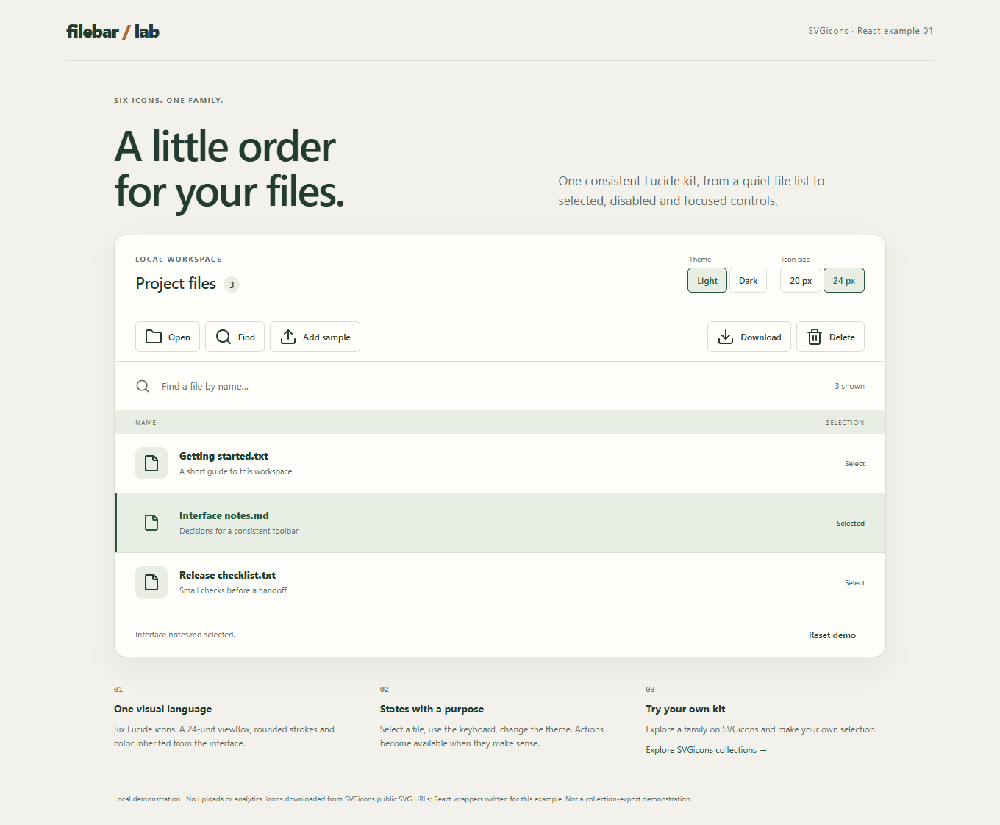

# Six icons, one React file toolbar

A React + TypeScript example of a consistent icon family in a working interface: selection, disabled actions, keyboard focus, text preview and a recoverable empty state. Six Lucide icons, two sizes, two themes, no backend.

Prepared by the [SVGicons](https://svgicons.com) team. The icon artwork is by Lucide and its contributors, with the applicable Feather attribution retained.



[Dark theme, 20 px](docs/screenshots/dark-20.png) | [Mobile layout](docs/screenshots/mobile-light.png)

These are unedited browser captures of this application, not images of the SVGicons export interface. Capture details and source hashes are in [capture.json](docs/screenshots/capture.json).

## Run it

Requirements: **Node.js 24.21.0**, its bundled npm, and a modern browser. Download the repository files, open a terminal in their directory, then run:

```sh
npm ci --ignore-scripts
npm run dev -- --port 5173 --strictPort
```

Open **http://127.0.0.1:5173/**. Stop with **Ctrl+C**. If that port is occupied, stop the existing server or choose a different local port explicitly. Both development and preview scripts bind to `127.0.0.1`.

No SVGicons account, API key or environment file is required to run the supplied assets. The application has no analytics and makes no external requests during ordinary interaction. Following its product link opens SVGicons.

Dependencies are pinned in `package-lock.json`. `.npmrc` disables dependency lifecycle scripts; the commands below invoke only the project's inspected build and test scripts. On Windows, use `npm.cmd` if PowerShell blocks `npm.ps1`.

## Build and check

```sh
npm run build
npm test
npm run preview
```

The build runs TypeScript checking and Vite. Tests require an installed **Microsoft Edge**: Playwright uses the `msedge` channel and does not download a browser. `npm test` first verifies the six SVGs, licence snapshot and React wrapper against their recorded hashes, then runs eight browser tests against the production build. Run the build first, and keep port 4173 free for the test server. Preview is available at **http://127.0.0.1:4173/** after the tests finish; stop it with Ctrl+C.

The browser checks cover selection, preview, the requested sample download, deletion confirmation, filtering, recovery, keyboard focus, local sample creation, four theme/size combinations and mobile overflow. One scenario checks for unsolicited external requests and browser errors. Test screenshots and reports go to ignored `evidence/` and `test-results/` directories.

These checks are not a complete accessibility audit or a cross-browser certification. Screen-reader behavior and contrast still deserve manual review. Screenshots are review aids, not pixel-diff baselines.

## Inspect the states

| Action | Expected result | Implementation detail |
|---|---|---|
| Start without selecting a file | Open, Download and Delete are disabled | Native `disabled` buttons |
| Select a row, then select it again | Selection toggles; actions follow it | `aria-pressed`, visible text and border/background |
| Open a selected file | A text preview opens; Escape closes it | Native modal `dialog` |
| Download a selected file | Browser receives the sample text | Local `Blob`; no server download |
| Delete, then Cancel or Confirm | Cancellation preserves the row; confirmation removes it | In-memory data; Reset restores the initial list |
| Filter for an absent name | Selection clears and an empty state offers recovery | Actions depend on a currently visible selection |
| Press Find | Focus moves to the labelled search input | Input ref, visible focus styles |
| Add sample | A new fictional text item is selected | No file picker or upload, despite the upload glyph |
| Switch theme or icon size | Light/dark and 20/24 px variants | CSS `currentColor`, one SVG viewBox |

All data is fictional and held in memory. Refresh resets it. The demo does not browse, upload or delete files on your disk. An explicitly requested sample download may be saved by your browser.

## How the icons work

`src/icons.tsx` holds static JSX shapes and derives `IconName` from their keys. Its size prop accepts `20 | 24`; all shapes retain a `0 0 24 24` viewBox, rounded joins and line caps, a 2-unit stroke and `currentColor`.

```tsx
import { Icon } from './icons';

<button type="button" disabled={!selectedFile} onClick={downloadSelected}>
  <Icon name="download" size={24} />
  Download
</button>
```

The snippet illustrates usage; `selectedFile` and `downloadSelected` belong to the calling component. See `src/App.tsx` for the running implementation. The icon is decorative (`aria-hidden="true"`, `focusable="false"`); the button's text supplies its accessible name. Give any icon-only adaptation its own accessible label.

The wrapper does not inject arbitrary SVG markup at runtime. The optional, local Python 3 script `scripts/adapt-icons.py` converts the retained SVGs to static JSX and refreshes the wrapper hash. It makes no network requests and is not needed to build. If you change the inputs, review their source and licence, inspect the generated code, then rerun the checks; matching hashes alone do not prove safety or authorship.

## Six sources, one family

These exact SVG bytes were downloaded from **public SVGicons image URLs on 12 October 2026**. The catalogue identifies them as Lucide. The original downloads remain in `assets/icons/`; IDs, URLs, acquisition method, SHA-256 hashes and the pinned upstream licence revision are in [icon-sources.json](icon-sources.json).

| Icon | SVGicons catalogue | Retained file |
|---|---|---|
| Folder | [113270 / folder](https://svgicons.com/icon/113270/folder) | `assets/icons/folder.svg` |
| File | [113183 / file](https://svgicons.com/icon/113183/file) | `assets/icons/file.svg` |
| Search | [113793 / search](https://svgicons.com/icon/113793/search) | `assets/icons/search.svg` |
| Upload | [114058 / upload](https://svgicons.com/icon/114058/upload) | `assets/icons/upload.svg` |
| Download | [113147 / download](https://svgicons.com/icon/113147/download) | `assets/icons/download.svg` |
| Trash 2 | [114026 / trash-2](https://svgicons.com/icon/114026/trash-2) | `assets/icons/trash-2.svg` |

**No authenticated SVGicons Collection or Pro export was performed.** The React components were adapted locally: root dimensions became size props, SVG attribute names became JSX names, and decorative accessibility attributes were added. Geometry and paints were retained. This example demonstrates using a coherent kit in React; it does not demonstrate an automated product export or account workflow.

## Project map

- `src/`: application, typed icon wrapper and styles.
- `assets/icons/`, `icon-sources.json`: original SVGs and provenance.
- `licenses/lucide-LICENSE.txt`, `THIRD_PARTY_NOTICES.md`: icon notices and licence scope.
- `scripts/verify-icons.mjs`, `scripts/adapt-icons.py`: integrity checks and optional local adaptation.
- `tests/`, `playwright.config.ts`: browser checks and screenshot recipe.
- `docs/screenshots/`: real captures and their source/hash record.

## Licences

The original demonstration code is released under the [MIT License](LICENSE), **Copyright (c) 2026 AXIALIS SA**.

The six icons and their geometry in the React wrapper retain their upstream terms and copyright holders; AXIALIS SA does not claim ownership of this artwork. Preserve [the complete Lucide ISC and Feather MIT notices](licenses/lucide-LICENSE.txt) when redistributing them. The demo-code licence does not replace those notices. See [THIRD_PARTY_NOTICES.md](THIRD_PARTY_NOTICES.md) for dependency licences and redistribution scope. Dependencies retain their own package licences.

## Make your own selection

Explore [SVGicons collections](https://svgicons.com/project-kits?utm_source=github&utm_medium=referral&utm_campaign=marketing90days-20261012-20270109&utm_content=svgicons-m8-filebar-readme) to choose a family for your interface. This optional link carries campaign attribution parameters. Running this example requires no signup; SVGicons account and collection workflows are separate from the local demo.
